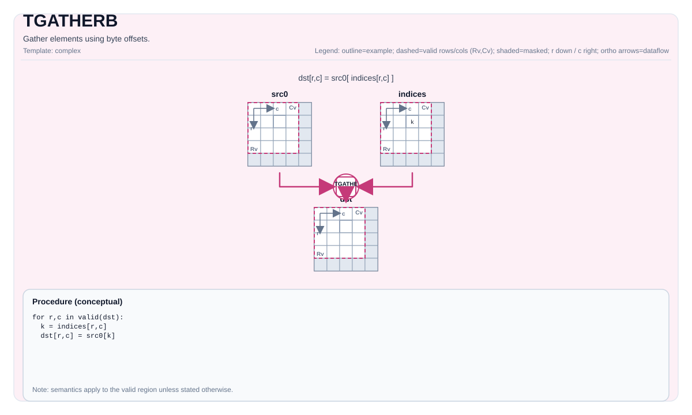

# TGATHERB

## Product Support<a name="section73648168211"></a>

<!-- npu="950" id1 -->
- Ascend 950PR&950DT products: Supported
<!-- end id1 -->
<!-- npu="A3" id2 -->
- Atlas A3 products: Supported
<!-- end id2 -->
<!-- npu="910b" id3 -->
- Atlas A2 products: Supported
<!-- end id3 -->


## Tile Operation Diagram



## Introduction

Gather data from the source tile by byte offset. Each element of `offset` is a `uint32_t` byte offset from the start of `src`, and each offset copies 32 bytes from that address into `dst`. The valid region of `dst` is split into 32-byte blocks, one offset per block. Element size is 1, 2, or 4 bytes. The hardware instruction is `vgatherb`.

## Math Interpretation

For each element in the valid region:

$$ \mathrm{dst}_{i,j} = *\left(\mathrm{srcBase} + \mathrm{offset}_{i,j}\right) $$

Exact bounds behavior is implementation-defined.

## C++ Intrinsic

Declared in `include/pto/common/pto_instr.hpp`:

```cpp
template <typename TileDataDst, typename TileDataSrc, typename TileDataOffset, typename... WaitEvents>
PTO_INST RecordEvent TGATHERB(TileDataDst &dst, TileDataSrc &src, TileDataOffset &offset, WaitEvents &... events);
```

## Constraints

- **Implementation checks (A2A3)**:
    - Destination layout must be row-major (`TileDataDst::isRowMajor`).
    - Destination element size must be `1`, `2`, or `4` bytes (enforced via `static_assert` in the helper).
    - `SrcTileData::DType`/`DstTileData::DType` must be `int8_t` or `uint8_t` or `int16_t` or `uint16_t` or `int32_t` or `uint32_t` or `half` or `bfloat16_t` or `float`.
- **Implementation checks (A5)**:
    - Destination element size must be `1`, `2`, or `4` bytes.
    - `SrcTileData::DType`/`DstTileData::DType` must be `int8_t` or `uint8_t` or `int16_t` or `uint16_t` or `int32_t` or `uint32_t` or `half` or `bfloat16_t` or `float`.
- **Offset interpretation**:
    - Offsets are interpreted as `uint32_t` values (byte offsets) by the implementation.
    - Offset bounds are not validated by explicit runtime assertions; out-of-range offsets are target-defined.

## Examples

### Auto

```cpp
#include <pto/pto-inst.hpp>

using namespace pto;

void example_auto() {
  using SrcT = Tile<TileType::Vec, uint8_t, 1, 256>;
  using OffT = Tile<TileType::Vec, uint32_t, 1, 256>;
  using DstT = Tile<TileType::Vec, uint8_t, 1, 256>;
  SrcT src;
  OffT off;
  DstT dst;
  TGATHERB(dst, src, off);
}
```

### Manual

```cpp
#include <pto/pto-inst.hpp>

using namespace pto;

void example_manual() {
  using SrcT = Tile<TileType::Vec, uint8_t, 1, 256>;
  using OffT = Tile<TileType::Vec, uint32_t, 1, 256>;
  using DstT = Tile<TileType::Vec, uint8_t, 1, 256>;
  SrcT src;
  OffT off;
  DstT dst;
  TASSIGN(src, 0x1000);
  TASSIGN(off, 0x2000);
  TASSIGN(dst, 0x3000);
  TGATHERB(dst, src, off);
}
```
