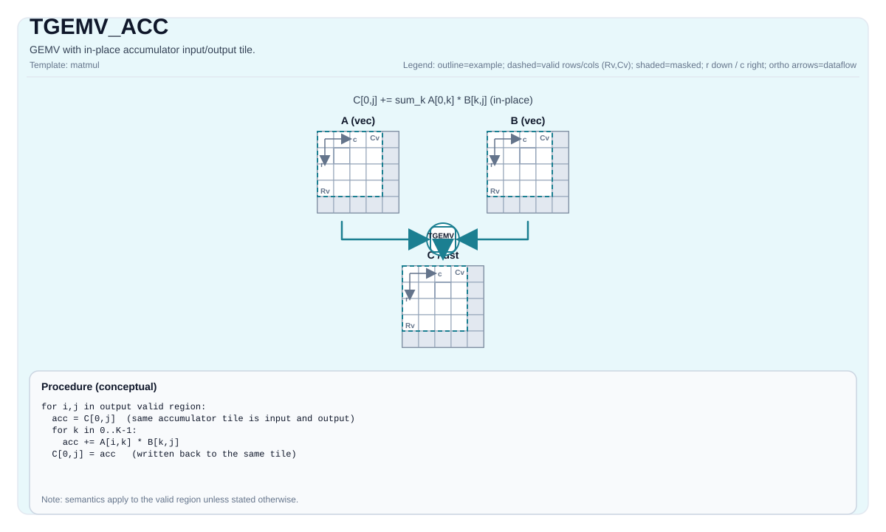

# TGEMV_ACC


## Tile Operation Diagram



## Introduction

Tile-based GEMV with accumulator input (fused accumulate). `cOutMatrix` and `cInMatrix` must reference the same accumulator tile; the operation updates that tile in place.

## See also

- Base GEMV instruction: `docs/isa/TGEMV.md`.
- Bias variant: `docs/isa/TGEMV_BIAS.md`.

## C++ Intrinsic

Declared in `include/pto/common/pto_instr.hpp`:

```cpp
template <typename TileRes, typename TileLeft, typename TileRight, typename... WaitEvents>
PTO_INST RecordEvent TGEMV_ACC(TileRes &cOutMatrix, TileRes &cInMatrix, TileLeft &aMatrix, TileRight &bMatrix, WaitEvents &... events);

template <AccPhase Phase, typename TileRes, typename TileLeft, typename TileRight, typename... WaitEvents>
PTO_INST RecordEvent TGEMV_ACC(TileRes &cOutMatrix, TileRes &cInMatrix, TileLeft &aMatrix, TileRight &bMatrix, WaitEvents &... events);
```

`cOutMatrix` and `cInMatrix` must reference the same accumulator tile; The underlying instruction takes a single C-matrix address, so accumulator input and output must use the same tile or the same address alias.

## Math Interpretation

Let:

- `M = 1`
- `K = bMatrix.GetValidRow()`
- `N = bMatrix.GetValidCol()`

For `0 <= j < N` (accumulates into the existing output tile):

$$ \mathrm{C}_{0,j} \gets \mathrm{C}_{0,j} + \sum_{k=0}^{K-1} \mathrm{A}_{0,k} \cdot \mathrm{B}_{k,j} $$

The existing `C` element is the initial accumulator value for the fused multiply-accumulate sequence. It is not added after computing an independent dot product from zero; this distinction can affect floating-point rounding across K tiles. Datatype promotion remains target/implementation-defined.

## Constraints

### Common shape and location constraints

- Static shape constraints:
    - `TileLeft::Rows == TileRes::Rows`
    - `TileLeft::Cols == TileRight::Rows`
    - `TileRight::Cols == TileRes::Cols`
- Tile locations:
    - `TileLeft::Loc == Left`
    - `TileRight::Loc == Right`
    - `TileRes::Loc == Acc`
- Runtime valid-size constraints:
    - `m` must be `1`
    - `k` and `n` (taken from `bMatrix.GetValidRow()` and `bMatrix.GetValidCol()`) must be in `[1, 4095]`
- The `TMATMUL` accumulator pitch constraint also applies.
- `cOutMatrix.data() == cInMatrix.data()`; accumulator input and output must use the same tile or the same address alias.

### Datatype constraints

- **Implementation checks (A2A3)**:
    - Supported `(CType, AType, BType)` triples:
        - `(int32_t, int8_t, int8_t)`
        - `(float, half, half)`
        - `(float, float, float)`
        - `(float, bfloat16_t, bfloat16_t)`
- **Implementation checks (A5)**:
    - Accumulator type must be `int32_t` or `float`.
    - If `int32_t`: `AType == int8_t` and `BType == int8_t`.
    - If `float`: supports `half`, `bfloat16_t`, `float`, selected fp8 pairs, and `hifloat8_t/hifloat8_t` (target-defined).
    - Fractal/layout constraints are enforced:
        - Left: `Loc == Left`, `!isRowMajor`, `SFractal == RowMajor`
        - Right: `Loc == Right`, `isRowMajor`, `SFractal == ColMajor`
        - Acc: `Loc == Acc`, `!isRowMajor`, `SFractal == RowMajor`
    - No separate explicit `m/k/n` runtime assertions are enforced in the underlying A5 matmul implementation beyond the GEMV contract described above.

- **Implementation checks (CPU_SIM, FP8/HIF8)**: Input type combinations, A5 simulation mode, and
  numerical limits follow [TMATMUL](TMATMUL.md#constraints).

## Examples

### Auto

```cpp
#include <pto/pto-inst.hpp>

using namespace pto;

void example_auto() {
  using A = TileLeft<half, 1, 16>;
  using B = TileRight<half, 16, 16>;
  using C = TileAcc<float, 1, 16>;
  A a;
  B b;
  C c;
  TGEMV_ACC(c, c, a, b);
}
```

### Manual

```cpp
#include <pto/pto-inst.hpp>

using namespace pto;

constexpr int kTileNum = 4;

void example_manual() {
  using A = TileLeft<half, 1, 16>;
  using B = TileRight<half, 16, 16>;
  using C = TileAcc<float, 1, 16>;
  A a;
  B b;
  C c;
  TASSIGN(a, 0x1000);
  TASSIGN(b, 0x2000);
  TASSIGN(c, 0x3000);
  for (int i = 0; i < kTileNum; ++i) {
    if (i == 0) {
      TGEMV(c, a, b);
    } else {
      TGEMV_ACC(c, c, a, b);
    }
  }
}
```
