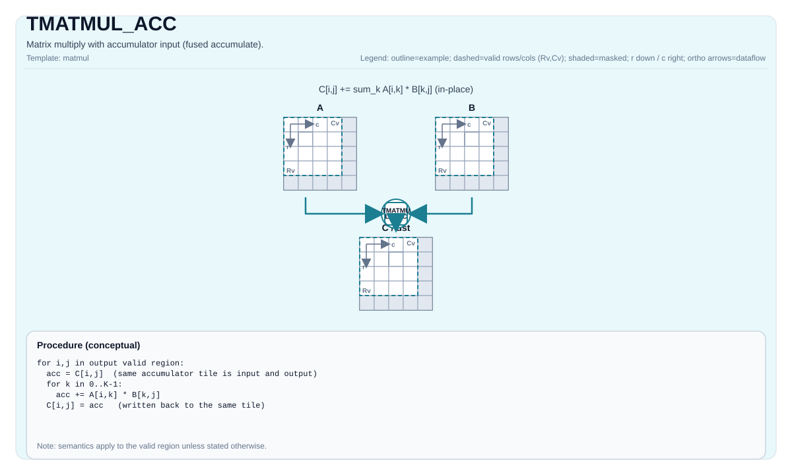

# TMATMUL_ACC

## 产品支持情况<a name="section73648168211"></a>

<!-- npu="950" id1 -->
- Ascend 950PR&950DT系列产品：支持
<!-- end id1 -->
<!-- npu="A3" id2 -->
- Atlas A3系列产品：支持
<!-- end id2 -->
<!-- npu="910b" id3 -->
- Atlas A2系列产品：支持
<!-- end id3 -->


## 指令示意图



## 简介

带累加器输入的矩阵乘法（融合累加）。

## 数学语义

设：

- `M = aMatrix.GetValidRow()`
- `K = aMatrix.GetValidCol()`
- `N = bMatrix.GetValidCol()`

对于 `0 <= i < M` 和 `0 <= j < N`：

$$ \mathrm{C}_{i,j} \leftarrow \mathrm{C}_{i,j} + \sum_{k=0}^{K-1} \mathrm{A}_{i,k} \cdot \mathrm{B}_{k,j} $$

该运算是原地累加：`cMatrix` 中已有的值是融合乘加序列的初始累加值，计算结果仍写回同一个 Tile。它并非先从零独立计算点积、再在末尾加上初始值；跨 K tile 累加时，两种顺序可能产生不同的浮点舍入结果。

## C++内建接口

声明于 `include/pto/common/pto_instr.hpp`：
> 公共包含头为 `<pto/pto-inst.hpp>`，内部声明位于 `pto/common/pto_instr.hpp`。

```cpp
template <typename TileRes, typename TileLeft, typename TileRight, typename... WaitEvents>
PTO_INST RecordEvent TMATMUL_ACC(TileRes &cOutMatrix, TileRes &cInMatrix, TileLeft &aMatrix, TileRight &bMatrix, WaitEvents &... events);

template <AccPhase Phase, typename TileRes, typename TileLeft, typename TileRight, typename... WaitEvents>
PTO_INST RecordEvent TMATMUL_ACC(TileRes &cOutMatrix, TileRes &cInMatrix, TileLeft &aMatrix, TileRight &bMatrix, WaitEvents &... events);

template <AccPhase Phase = AccPhase::Unspecified, typename TileRes, typename TileLeft, typename TileRight,
          typename... WaitEvents>
PTO_INST RecordEvent TMATMUL_ACC(TileRes &cMatrix, TileLeft &aMatrix, TileRight &bMatrix, WaitEvents &... events); // 注：该重载将 cMatrix 同时作为累加器输入与输出（原地），读取其现有值作为 C0，写回 C1 = C0 + A·B；既不清零也不覆盖
```

四参数重载接口仅为兼容既有调用形式保留，其中 `cOutMatrix` 和 `cInMatrix` 必须指向同一个累加器 Tile；推荐使用三参数重载接口 `TMATMUL_ACC(cMatrix, aMatrix, bMatrix)`。

## 约束

- 所有来自 `TMATMUL` 的约束都适用于 `(cOutMatrix, aMatrix, bMatrix)` 三元组。
 - **实现说明 (Atlas A2/A3 训练系列产品/Atlas A2/A3 推理系列产品/Ascend 950PR/Ascend 950DT/A6)**:
    - `TMATMUL_ACC_IMPL` 使用 `aMatrix.GetValidRow()`、`aMatrix.GetValidCol()` 和 `bMatrix.GetValidCol()` 作为 `m/k/n`。
    - 四参数形式要求 `cOutMatrix.data() == cInMatrix.data()`；底层指令只接收一个 C 矩阵地址，累加输入和输出必须使用同一个 Tile 或同一地址别名。

- **实现检查（CPU_SIM，FP8/HIF8）**：输入类型组合、A5 模拟模式要求及数值精度限制与
  [TMATMUL](TMATMUL_zh.md) 相同。

## 示例

### 自动（Auto）

```cpp
#include <pto/pto-inst.hpp>

using namespace pto;

void example_auto() {
  using A = TileLeft<half, 16, 16>;
  using B = TileRight<half, 16, 16>;
  using C = TileAcc<float, 16, 16>;
  A a;
  B b;
  C c;
  TMATMUL_ACC(c, a, b);
}
```

### 手动（Manual）

```cpp
#include <pto/pto-inst.hpp>

using namespace pto;

constexpr int kTileNum = 4;

void example_manual() {
  using A = TileLeft<half, 16, 16>;
  using B = TileRight<half, 16, 16>;
  using C = TileAcc<float, 16, 16>;
  A a;
  B b;
  C c;
  TASSIGN(a, 0x1000);
  TASSIGN(b, 0x2000);
  TASSIGN(c, 0x3000);
  for (int i = 0; i < kTileNum; ++i) {
    // The first tile initializes C; subsequent tiles accumulate in place.
    if (i == 0) {
      TMATMUL(c, a, b);
    } else {
      TMATMUL_ACC(c, c, a, b);
    }
  }
}
```
