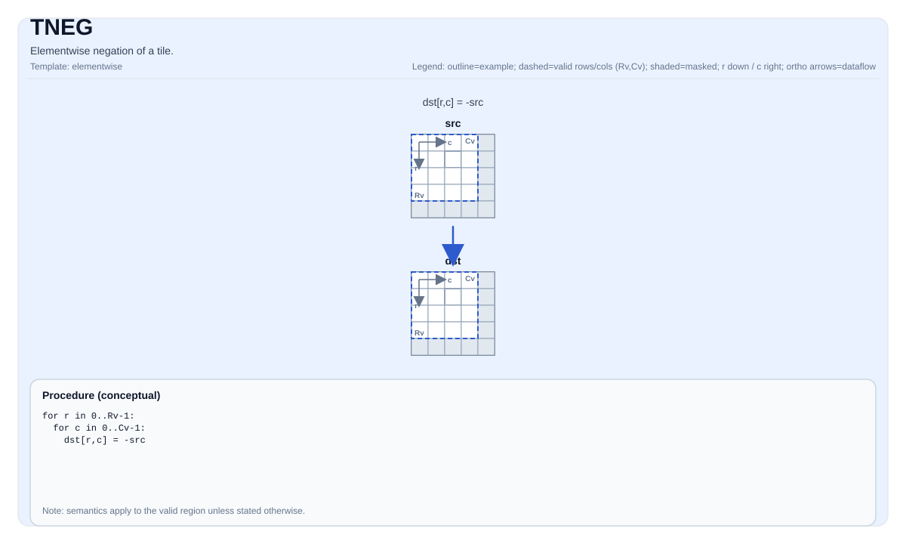

# TNEG

## Product Support<a name="section73648168211"></a>

<!-- npu="950" id1 -->
- Ascend 950PR&950DT products: Supported
<!-- end id1 -->
<!-- npu="A3" id2 -->
- Atlas A3 products: Supported
<!-- end id2 -->
<!-- npu="910b" id3 -->
- Atlas A2 products: Supported
<!-- end id3 -->


## Tile Operation Diagram



## Introduction

Elementwise negation of a tile.

## Math Interpretation

For each element `(i, j)` in the valid region:

$$ \mathrm{dst}_{i,j} = -\mathrm{src}_{i,j} $$

## C++ Intrinsic

Declared in `include/pto/common/pto_instr.hpp`:

```cpp
template <typename TileDataDst, typename TileDataSrc, typename... WaitEvents>
PTO_INST RecordEvent TNEG(TileDataDst &dst, TileDataSrc &src, WaitEvents &... events);
```

## Constraints

- The op iterates over `dst.GetValidRow()` / `dst.GetValidCol()`.
- **Implementation checks (A2A3)**: `TileData::DType` must be one of: `int32_t`, `int16_t`, `half`, `float`.
- **Implementation checks (A5)**: `TileData::DType` must be one of: `int32_t`, `int16_t`, `uint32_t`, `uint16_t`, `half`, `float`, `bfloat16_t`.

## Examples

```cpp
#include <pto/pto-inst.hpp>

using namespace pto;

void example() {
  using TileT = Tile<TileType::Vec, float, 16, 16>;
  TileT x, out;
  TNEG(out, x);
}
```
