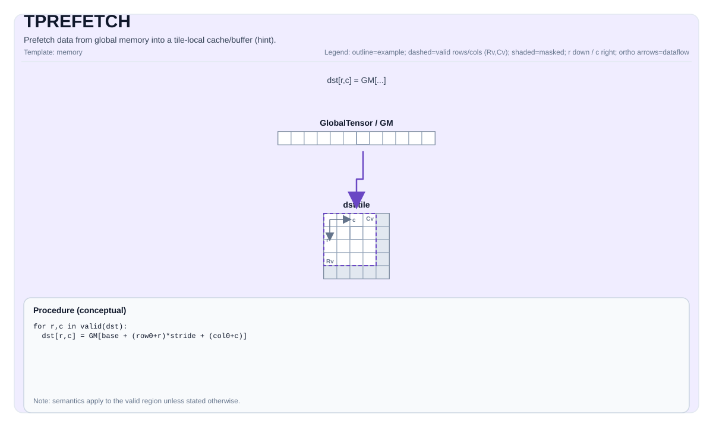

# TPREFETCH

## 产品支持情况<a name="section73648168211"></a>

<!-- npu="950" id1 -->
- Ascend 950PR&950DT系列产品：支持
<!-- end id1 -->
<!-- npu="A3" id2 -->
- Atlas A3系列产品：支持
<!-- end id2 -->
<!-- npu="910b" id3 -->
- Atlas A2系列产品：支持
<!-- end id3 -->


## 指令示意图



## 简介

将数据从全局内存预取到Tile本地缓存/缓冲区（实现定义）。这通常用于在随后的 `TLOAD` 之前减少延迟。

注意：与大多数PTO指令不同，`TPREFETCH` 在C++包装器中**不会**隐式调用 event waits。

## 数学语义

除非另有说明，语义在有效区域上定义，目标相关的行为标记为实现定义。

## C++内建接口

声明于 `include/pto/common/pto_instr.hpp`：
> 公共包含头为 `<pto/pto-inst.hpp>`，内部声明位于 `pto/common/pto_instr.hpp`。

```cpp
template <typename TileData, typename GlobalData>
PTO_INST RecordEvent TPREFETCH(TileData &dst, GlobalData &src);
```

## 约束

- 语义和缓存行为由目标/实现定义。
- 某些目标可能会忽略预取，将其视为提示。

## 示例

参见 `docs/isa/` 和 `docs/coding/tutorials/` 中的相关示例。
