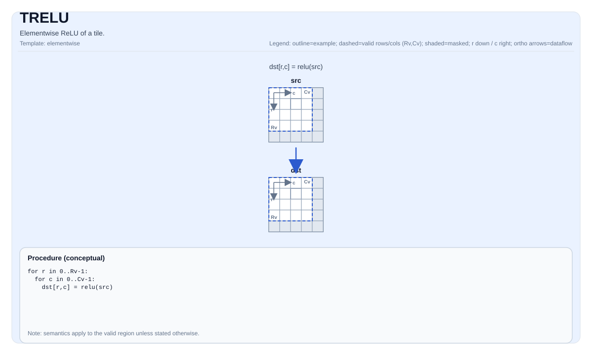

# TRELU

## Product Support<a name="section73648168211"></a>

<!-- npu="950" id1 -->
- Ascend 950PR&950DT products: Supported
<!-- end id1 -->
<!-- npu="A3" id2 -->
- Atlas A3 products: Supported
<!-- end id2 -->
<!-- npu="910b" id3 -->
- Atlas A2 products: Supported
<!-- end id3 -->


## Tile Operation Diagram



## Introduction

Elementwise ReLU of a tile.

## Math Interpretation

For each element `(i, j)` in the valid region:

$$ \mathrm{dst}_{i,j} = \max(\mathrm{src}_{i,j}, 0) $$

## C++ Intrinsic

Declared in `include/pto/common/pto_instr.hpp`:

```cpp
template <typename TileDataDst, typename TileDataSrc, typename... WaitEvents>
PTO_INST RecordEvent TRELU(TileDataDst &dst, TileDataSrc &src, WaitEvents &... events);
```

## Constraints

- **Implementation checks (A2A3)**:
    - `TileData::DType` must be one of: `half`, `float`, `int32_t`.
    - Tile layout must be row-major (`TileData::isRowMajor`).
    - Tile location must be vector (`TileData::Loc == TileType::Vec`).
    - Static valid bounds: `TileData::ValidRow <= TileData::Rows` and `TileData::ValidCol <= TileData::Cols`.
    - Runtime: `src` and `dst` tiles should have the same `validRow/validCol`.
- **Implementation checks (A5)**:
    - `TileData::DType` must be one of: `half`, `float`, `int32_t`.
    - Tile layout must be row-major (`TileData::isRowMajor`).
    - Tile location must be vector (`TileData::Loc == TileType::Vec`).
    - Static valid bounds: `TileData::ValidRow <= TileData::Rows` and `TileData::ValidCol <= TileData::Cols`.
    - Runtime: `src` and `dst` tiles should have the same `validRow/validCol`.
- **Valid region**:
    - The op uses `dst.GetValidRow()` / `dst.GetValidCol()` as the iteration domain; `src/dst` are assumed to be compatible (not validated by explicit runtime checks in this op).

## Examples

```cpp
#include <pto/pto-inst.hpp>

using namespace pto;

void example() {
  using TileT = Tile<TileType::Vec, float, 16, 16>;
  TileT x, out;
  TRELU(out, x);
}
```
